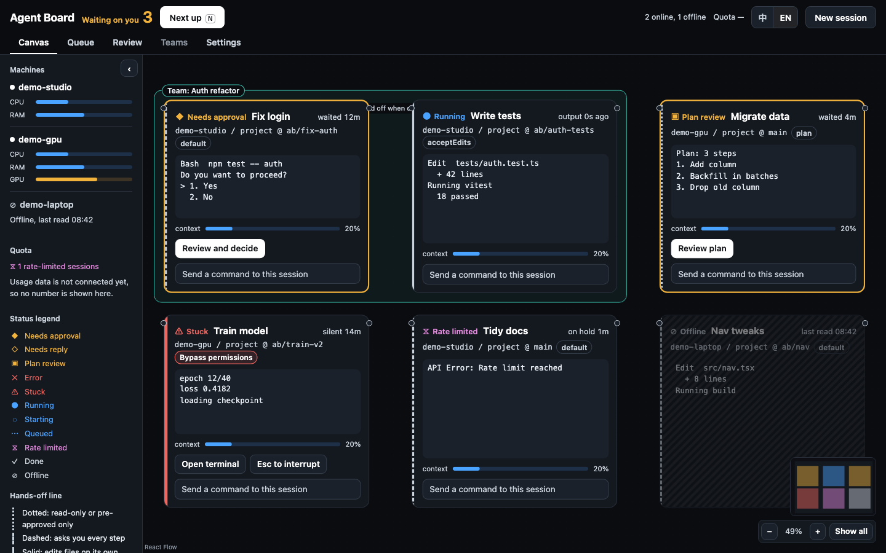
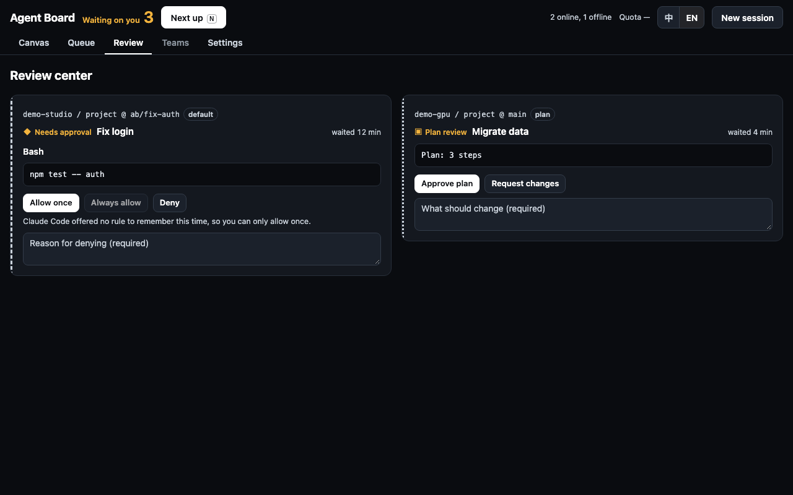
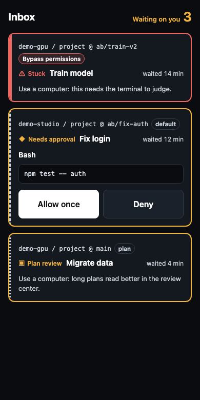
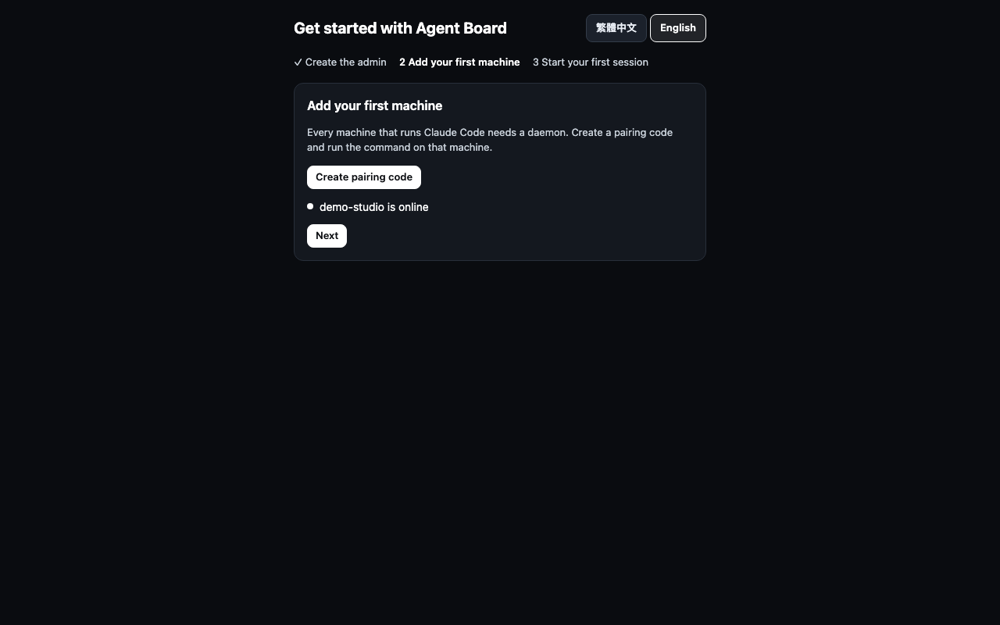

# Agent Board

[繁體中文](README.zh-TW.md)

A self-hosted web console for all your Claude Code sessions, across all your computers. Each machine runs its own logged-in `claude`; the page is only a remote control. Close the browser and every session keeps running.



- **The real terminal.** xterm.js draws Claude Code's raw output. Nothing is re-rendered or imitated.
- **Approve from anywhere.** See the diff and answer permission requests on the web or your phone.
- **No model access of its own.** It does not call any LLM, needs no API key, and sends no telemetry. It uses each machine's own `claude` login.
- **Private by default.** It listens on localhost or a private network and always requires a login.

| Review center                                 | Phone inbox                          |
| --------------------------------------------- | ------------------------------------ |
|  |  |

## Platform status

| OS      | Status                                                                         |
| ------- | ------------------------------------------------------------------------------ |
| macOS   | Tested                                                                         |
| Linux   | **Untested.** Install scripts and systemd units exist, never run on real Linux |
| Windows | **Untested.** Install scripts and scheduled tasks exist, never run on Windows  |

## Before you start

You need these on every machine that will run sessions:

- [Node.js](https://nodejs.org) 22.18 or newer, with npm. Check with `node -v`.
- [Claude Code](https://code.claude.com), logged in. Run `claude` once in a terminal and finish the login.
- Linux only: tools to build `node-pty`, because it has no Linux prebuilt binary. On Debian or Ubuntu: `sudo apt install build-essential python3`.

The machine that only runs the hub needs Node.js alone. One computer can be both.

## Set it up

### 1. Install the hub

Pick one computer to host the web console.

```sh
curl -fsSL https://github.com/OWNER/agent-board/releases/latest/download/install.sh | sh -s -- hub
```

On Windows, in PowerShell:

```powershell
Invoke-WebRequest https://github.com/OWNER/agent-board/releases/latest/download/install.ps1 -OutFile install.ps1
powershell -ExecutionPolicy Bypass -File install.ps1 hub
```

No root or administrator rights are needed. It ends by printing the address, `http://127.0.0.1:8787` by default. If that port is taken, add `--port 9000` after `hub`.

To build from source instead of downloading a release, see [Install from source](#install-from-source).

### 2. Create the admin account

Open that address in a browser. The first visit starts a setup guide: choose your language, enter an admin name, and pick a password of at least 8 characters.



### 3. Add your first machine

In the guide, press **Create pairing code**. The page shows a code, which is valid for a limited time and works once, and a command containing your hub's address.

On the machine that will run sessions, put those two values into the install command:

```sh
curl -fsSL https://github.com/OWNER/agent-board/releases/latest/download/install.sh | sh -s -- daemon --hub 'http://127.0.0.1:8787' --code YOUR-CODE
```

On Windows:

```powershell
powershell -ExecutionPolicy Bypass -File install.ps1 daemon --hub 'http://127.0.0.1:8787' --code YOUR-CODE
```

Optionally add `--name 'my laptop'`. The default name is the computer's hostname.

The guide updates by itself when the machine connects. Press **Next**.

> If the daemon is already installed on that machine, just paste the command the page shows (`agent-board-daemon pair ...`). The service retries and connects within about a minute.

### 4. Start your first session

Choose a working directory and a permission mode, then start the session.

**The first time `claude` opens a folder, it asks whether you trust the folder. Answer this, or the session goes no further.** Open the session's terminal on the web and choose `Yes, I trust this folder`. The preselected option is `No, exit`, which ends the session. Claude Code runs no hooks until you answer, so status lights and web approvals begin after that.

You're done. Sessions keep running when you close the page, and the hub and daemon start again on their own after a reboot and login.

## Using it across machines

The hub listens on `127.0.0.1` only. To reach it from other machines, use a private network. **Agent Board has no public internet mode:** whoever gets in controls terminals on all your machines. Listening on all interfaces (`0.0.0.0`, `::`) is refused. Do not expose it with port forwarding or a public tunnel such as `tailscale funnel`.

### Recommended: a reverse proxy on a private network

With [Tailscale](https://tailscale.com), on the hub machine:

```sh
tailscale serve --bg 8787
```

Check `tailscale serve --help` if your version's syntax differs. Then:

1. Open the hub at `http://127.0.0.1:8787` on the hub machine.
2. Go to **Settings → Security → Public origin** and enter the HTTPS address, such as `https://your-hub.your-tailnet.ts.net`. Save.
3. Use that address from now on, including `--hub` when pairing.

**You must set the public origin behind any reverse proxy.** Without it, WebSocket connections are rejected as coming from the wrong origin, pairing commands show the wrong address, and login cookies aren't marked `Secure`. The same applies to Caddy, nginx, and others.

Web Push and installing as a phone app need HTTPS, so this is also the setup for phone use.

### Alternative: listen on a private IP

```sh
sh install.sh hub --host 100.64.0.1   # use this machine's own private IP
```

Traffic is plain HTTP, so only do this on a network that already encrypts it, such as Tailscale. When `--host` is set, it overrides the listen address in Settings.

## Everyday commands

Data lives in `~/.agent-board` (`hub.db`, `machine.json`, `sessions.json`, `logs/`). Programs live in `~/.local/share/agent-board`, or `%LOCALAPPDATA%\agent-board` on Windows.

| Task    | macOS                                                        | Linux                                         | Windows                                      |
| ------- | ------------------------------------------------------------ | --------------------------------------------- | -------------------------------------------- |
| Status  | `launchctl print gui/$(id -u)/com.agent-board.daemon`        | `systemctl --user status agent-board-daemon`  | `schtasks /Query /TN AgentBoard-daemon`      |
| Restart | `launchctl kickstart -k gui/$(id -u)/com.agent-board.daemon` | `systemctl --user restart agent-board-daemon` | `schtasks /End` then `/Run`                  |
| Logs    | `~/.agent-board/logs/daemon.log`                             | same                                          | `%USERPROFILE%\.agent-board\logs\daemon.log` |

Replace `daemon` with `hub` for the hub.

**Upgrade:** run the same install command again. If nothing changed, nothing restarts. If it did, services restart, and daemons reattach their sessions with `claude --resume`.

**Options:** `--port`, `--host`, `--name`, `--claude-bin <path>`, `--repair` (pair again, even if already paired), `--no-service` (don't set up auto-start), `--no-start` (write the service files without starting them), `--from <tar.gz or folder>`.

More about auto-start, including why Windows uses a scheduled task: [docs/install/services.en.md](docs/install/services.en.md).

## Troubleshooting

| What you see                                                 | What to do                                                                                                                                                                                    |
| ------------------------------------------------------------ | --------------------------------------------------------------------------------------------------------------------------------------------------------------------------------------------- |
| `agent-board-daemon: command not found`                      | `~/.local/bin` isn't on your `PATH`. Add it, or use the full path `~/.local/bin/agent-board-daemon`. On Windows, open a new terminal.                                                         |
| `... is already in use`                                      | Add `--port 9000`. If machines are already paired, pair them again because the hub address changed.                                                                                           |
| `Cannot find claude`                                         | Add `--claude-bin /full/path/to/claude`. Find it with `which claude`.                                                                                                                         |
| The machine stays offline                                    | Read the daemon log. A message about a missing machine token (`沒有機器 token`) means it isn't paired yet. One about reaching the hub (`連不到 hub`) means check the address and the network. |
| Pairing rejected                                             | Codes work once and expire. Create a new one in **Settings**.                                                                                                                                 |
| Session ends right after starting                            | You may have answered `No, exit` to the trust question, or `claude` may not be logged in on that machine. Run `claude` there by hand once.                                                    |
| Session won't start and mentions `settings.local.json`       | That project's `.claude/settings.local.json` isn't valid JSON. Agent Board won't overwrite it. Fix the file.                                                                                  |
| Session won't start, and mentions `agent-board-hook`         | Without this hook the dangerous-command check can't run, so sessions are refused. Run the install command again.                                                                              |
| The page keeps disconnecting behind a proxy                  | Set the public origin (see above).                                                                                                                                                            |
| macOS: `Operation not permitted` in Desktop or Documents     | macOS privacy protection limits background programs. Allow `node` under **System Settings → Privacy & Security → Files and Folders**, or use another folder.                                  |
| macOS: `launchctl bootstrap` fails                           | You probably ran the installer over SSH with no desktop login. The service starts at the next desktop login. A LaunchAgent starts at login, not at boot.                                      |
| Linux: `npm ci` fails on `node-pty`                          | Install the build tools listed in [Before you start](#before-you-start).                                                                                                                      |
| Linux: `systemctl --user` unavailable (some containers, WSL) | Start by hand: `~/.local/bin/agent-board-daemon`.                                                                                                                                             |
| Linux: doesn't start after reboot until you log in           | Run `loginctl enable-linger $USER`. The installer tries this for you.                                                                                                                         |
| Services stopped after removing a Node version (nvm etc.)    | Run the install command again with the new Node version.                                                                                                                                      |
| Log files are large                                          | Logs aren't rotated yet. Deleting them is safe; restart the service afterwards.                                                                                                               |

## Uninstall

```sh
sh ~/.local/share/agent-board/app/scripts/install.sh --uninstall
```

On Windows:

```powershell
powershell -ExecutionPolicy Bypass -File "$env:LOCALAPPDATA\agent-board\app\scripts\install.ps1" --uninstall
```

This removes the programs, services, and shortcuts. Your data stays in `~/.agent-board`. Add `--purge` to delete that too, including the hub database and the machine's credentials.

One thing has to be cleaned by hand. Each project that had a session keeps Agent Board's hooks in `.claude/settings.local.json`. Delete the entries whose `command` starts with `agent-board-hook`. If you leave them, `claude` will report a hook error on each tool call in those projects.

## Install from source

Needed until a release is published, or for development. Requires `git` and network access for dependencies.

```sh
git clone https://github.com/OWNER/agent-board.git
cd agent-board
corepack pnpm install
corepack pnpm build:release
sh scripts/install.sh hub --from release/agent-board.tar.gz
```

Then use the same `--from` for the daemon. To set up other machines, copy `release/agent-board.tar.gz` to them.

## What the installer does

- Downloads only this project's release file and its npm dependencies. It sends no data anywhere, and `npm audit` is turned off.
- Writes only under your home directory and needs no root.
- Won't overwrite files in `~/.local/bin` that it didn't create. It doesn't edit your shell configuration.
- Stores the machine token only in `~/.agent-board/machine.json` (mode 0600), never in service files.
- On Linux, it runs `loginctl enable-linger` for your user so services start at boot. On Windows, it adds its folder to your user `PATH`.

## License

MIT. Third-party licenses: [THIRD_PARTY_NOTICES.md](THIRD_PARTY_NOTICES.md).
