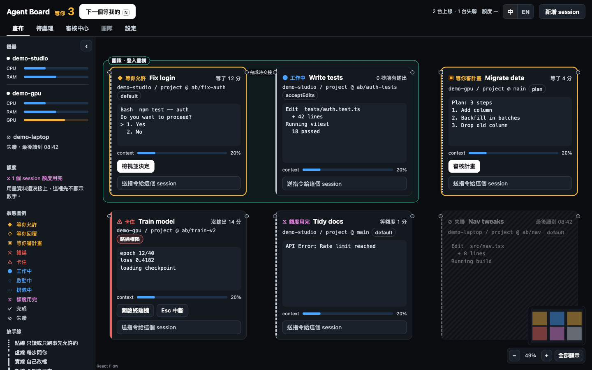
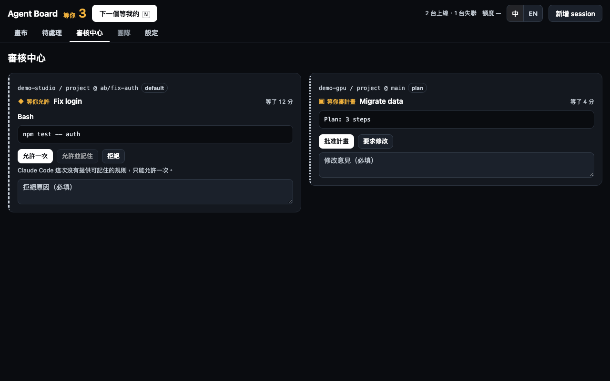
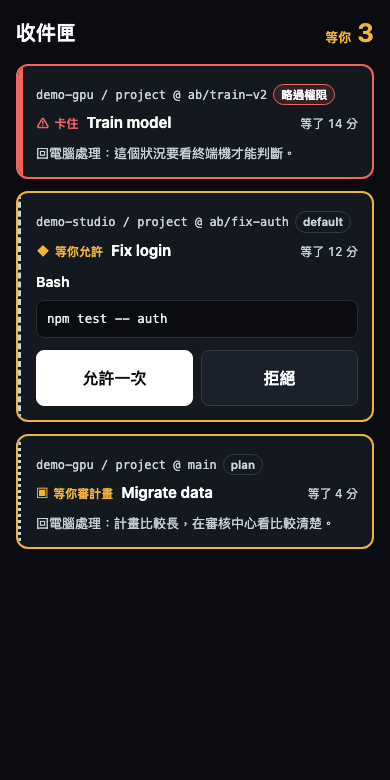
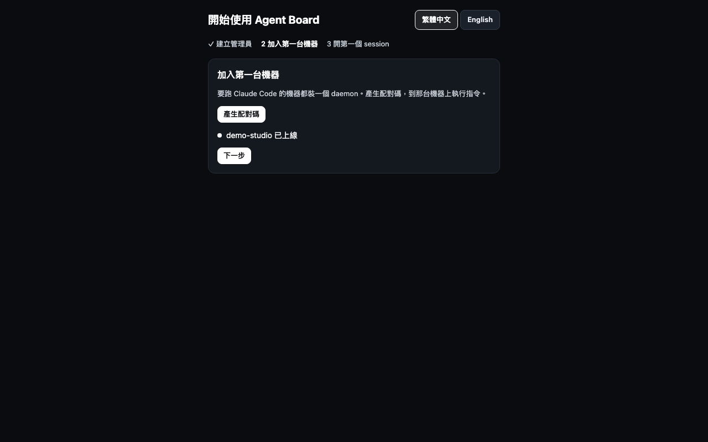

# Agent Board

[English](README.md)

自架的網頁中控台，管理你所有電腦上的 Claude Code session。每台機器跑自己已登入的 `claude`，網頁只是遙控器；關掉瀏覽器，session 照樣在跑。



- **真的終端機。** 用 xterm.js 畫 Claude Code 的原始輸出，不模仿、不重新排版。
- **到哪都能核准。** 在網頁或手機上看 diff、回答權限請求。
- **本身不碰模型。** 不呼叫任何 LLM、不需要 API key、不回傳使用資料，用的是每台機器自己的 `claude` 登入。
- **預設私有。** 只監聽 localhost 或私有網路，一定要登入。

| 審核中心                                       | 手機待處理                                  |
| ---------------------------------------------- | ------------------------------------------- |
|  |  |

## 各平台狀態

| 作業系統 | 狀態                                                            |
| -------- | --------------------------------------------------------------- |
| macOS    | 已測試                                                          |
| Linux    | **未測試。** 安裝腳本與 systemd 設定已備妥，沒在真 Linux 上跑過 |
| Windows  | **未測試。** 安裝腳本與排程工作已備妥，沒在 Windows 上跑過      |

## 開始之前

每台要跑 session 的機器都需要：

- [Node.js](https://nodejs.org) 22.18 以上（含 npm）。用 `node -v` 確認。各台的版本不必一樣：hub、daemon 與 session host 都用安裝時找到的那支 node，附的原生模組不分 Node 版本。
- [Claude Code](https://code.claude.com)，而且已登入。在終端機執行一次 `claude`，完成登入。
- 僅 Linux：編譯 `node-pty` 的工具，因為它沒有 Linux 預編譯檔。Debian／Ubuntu：`sudo apt install build-essential python3`。

只跑 hub 的機器只需要 Node.js。同一台電腦可以兩者都裝。

## 安裝

### 1. 裝 hub

選一台電腦放網頁中控台。

```sh
curl -fsSL https://github.com/OWNER/agent-board/releases/latest/download/install.sh | sh -s -- hub
```

Windows 用 PowerShell：

```powershell
Invoke-WebRequest https://github.com/OWNER/agent-board/releases/latest/download/install.ps1 -OutFile install.ps1
powershell -ExecutionPolicy Bypass -File install.ps1 hub
```

不需要 root 或系統管理員權限。裝完會印出網址，預設是 `http://127.0.0.1:8787`。如果這個埠被占用，在 `hub` 後面加 `--port 9000`。

想從原始碼建置而不下載發布檔，見[從原始碼安裝](#從原始碼安裝)。

### 2. 建立管理員帳號

用瀏覽器打開那個網址。第一次開啟會進入引導：選語言、填管理員名稱、設定至少 8 個字元的密碼。



### 3. 加入第一台機器

在引導中按**產生配對碼**。畫面會顯示配對碼（有時效、只能用一次）和一行含有 hub 網址的指令。

到要跑 session 的機器上，把這兩個值填進安裝指令：

```sh
curl -fsSL https://github.com/OWNER/agent-board/releases/latest/download/install.sh | sh -s -- daemon --hub 'http://127.0.0.1:8787' --code 你的配對碼
```

Windows：

```powershell
powershell -ExecutionPolicy Bypass -File install.ps1 daemon --hub 'http://127.0.0.1:8787' --code 你的配對碼
```

可以另外加 `--name '我的筆電'`，不加就用電腦的主機名稱。

機器連上後，引導畫面會自動更新。按**下一步**。

> 如果這台機器已經裝過 daemon，直接貼上畫面顯示的指令（`agent-board-daemon pair ...`）就好。服務會自動重試，大約一分鐘內連上。

### 4. 開第一個 session

選工作目錄和權限模式，開始 session。

**`claude` 第一次開某個資料夾時，會問你是否信任它。一定要回答，否則 session 不會往下走。** 在網頁上打開該 session 的終端機，選 `Yes, I trust this folder`。預先選好的是 `No, exit`，選它 session 就結束了。回答之前 Claude Code 不會執行 hook，所以狀態燈和網頁核准要等回答後才開始運作。

這樣就完成了。關掉網頁 session 繼續跑；重開機並登入後，hub 和 daemon 會自動啟動。

## 跨機器使用

hub 只監聽 `127.0.0.1`。要從其他機器連，請用私有網路。**Agent Board 沒有公開網路模式：** 能進來的人就能控制你所有機器的終端機。監聽所有網卡（`0.0.0.0`、`::`）會被拒絕。不要用連接埠轉發或 `tailscale funnel` 這類公開通道對外開放。

### 建議：私有網路上的反向代理

用 [Tailscale](https://tailscale.com) 的話，在 hub 那台機器上：

```sh
tailscale serve --bg 8787
```

你的版本語法不同的話，請看 `tailscale serve --help`。接著：

1. 在 hub 那台機器上打開 `http://127.0.0.1:8787`。
2. 到**設定 → 安全 → 對外網址**，填 HTTPS 網址，例如 `https://your-hub.your-tailnet.ts.net`，儲存。
3. 之後都用這個網址，包含配對時的 `--hub`。

**只要經過反向代理，就一定要設對外網址。** 沒設的話，WebSocket 連線會因來源不符被拒絕、配對指令顯示錯的網址、登入 cookie 也不會標記 `Secure`。Caddy、nginx 等也一樣。

Web Push 和安裝成手機 App 都需要 HTTPS，所以要在手機上用也是這個設定。

### 替代做法：監聽私有 IP

```sh
sh install.sh hub --host 100.64.0.1   # 換成這台機器自己的私有 IP
```

傳輸是未加密的 HTTP，只適合本來就有加密的網路（例如 Tailscale）。設了 `--host` 後，它會蓋過設定頁的監聽位址。

## 日常指令

資料在 `~/.agent-board`（`hub.db`、`machine.json`、`sessions.json`、`logs/`）。程式在 `~/.local/share/agent-board`，Windows 在 `%LOCALAPPDATA%\agent-board`。

| 要做什麼 | macOS                                                        | Linux                                         | Windows                                      |
| -------- | ------------------------------------------------------------ | --------------------------------------------- | -------------------------------------------- |
| 看狀態   | `launchctl print gui/$(id -u)/com.agent-board.daemon`        | `systemctl --user status agent-board-daemon`  | `schtasks /Query /TN AgentBoard-daemon`      |
| 重新啟動 | `launchctl kickstart -k gui/$(id -u)/com.agent-board.daemon` | `systemctl --user restart agent-board-daemon` | `schtasks /End` 再 `/Run`                    |
| 紀錄     | `~/.agent-board/logs/daemon.log`                             | 相同                                          | `%USERPROFILE%\.agent-board\logs\daemon.log` |

hub 就把 `daemon` 換成 `hub`。

**升級：** 重跑一次同樣的安裝指令。內容沒變就什麼都不會重啟；有變的話服務會重啟，daemon 用 `claude --resume` 接回 session。

**退版：** hub 升級資料庫結構（schema）前，會自動把舊的 `hub.db` 備份成同資料夾的 `hub.db.bak-<日期>-<時間>-v<舊版本>`（本機時間、不含時區；只有擁有者能讀寫），備份路徑會寫進 hub 的 log；備份失敗就不升級。新版有問題要退回舊版時：

1. 停掉 hub 服務（macOS：`launchctl bootout gui/$(id -u)/com.agent-board.hub`；Linux：`systemctl --user stop agent-board-hub`；Windows：`schtasks /End /TN AgentBoard-hub`）。
2. 把要退回的那個備份複製回去，例如 `cp ~/.agent-board/hub.db.bak-20261108-090507-v8 ~/.agent-board/hub.db`，並刪掉同資料夾的 `hub.db-wal`、`hub.db-shm`（如果有）。備份之後的變更會遺失。
3. 用舊版的安裝檔重跑安裝指令（`--from <舊版 tar.gz 或資料夾>`）裝回舊版。

舊版 hub 開到新版資料庫時會拒絕啟動，錯誤訊息會列出同資料夾裡它能用的最新備份檔（依檔名裡的時間判斷；剛遇到夏令時間切換或改過時區時，請自己再看一下檔案時間）。

**選項：** `--port`、`--host`、`--name`、`--claude-bin <路徑>`、`--repair`（已配對也重新配對）、`--no-service`（不設開機自動啟動）、`--no-start`（只寫服務設定、不啟動）、`--from <tar.gz 或資料夾>`。

開機自動啟動的細節，包含 Windows 為什麼用排程工作：[docs/install/services.md](docs/install/services.md)。

## 疑難排解

| 看到什麼                                              | 怎麼做                                                                                                              |
| ----------------------------------------------------- | ------------------------------------------------------------------------------------------------------------------- |
| `agent-board-daemon: command not found`               | `~/.local/bin` 不在 `PATH` 上。把它加進去，或用完整路徑 `~/.local/bin/agent-board-daemon`。Windows 請開新的終端機。 |
| `已被其他程式使用`                                    | 加 `--port 9000`。如果已有配對好的機器，hub 網址變了，要重新配對。                                                  |
| `找不到 claude`                                       | 加 `--claude-bin /完整/路徑/claude`，路徑可用 `which claude` 查。                                                   |
| 機器一直離線                                          | 看 daemon 紀錄。「沒有機器 token」表示還沒配對；「連不到 hub」請檢查網址與網路。                                    |
| 配對被拒絕                                            | 配對碼只能用一次，也會過期。到**設定**產生新的。                                                                    |
| session 一開就結束                                    | 可能信任對話框選了 `No, exit`，或那台機器的 `claude` 沒登入。到那台機器手動執行一次 `claude`。                      |
| session 開不起來，訊息提到 `settings.local.json`      | 該專案的 `.claude/settings.local.json` 不是合法 JSON。Agent Board 不會覆蓋它，請修好檔案。                          |
| session 開不起來：`找不到可執行的 agent-board-hook`   | 少了這支 hook，危險指令檢查無法執行，所以會拒絕開 session。重跑一次安裝指令。                                       |
| 經代理時網頁一直斷線                                  | 設定對外網址（見上）。                                                                                              |
| macOS：桌面或文件資料夾出現 `Operation not permitted` | macOS 隱私保護會限制背景程式。到**系統設定 → 隱私權與安全性 → 檔案和資料夾**允許 `node`，或改用其他資料夾。         |
| macOS：`launchctl bootstrap` 失敗                     | 多半是透過 SSH 執行、沒有桌面登入。下次登入桌面時服務會啟動。LaunchAgent 是登入時啟動，不是開機時。                 |
| Linux：`npm ci` 卡在 `node-pty`                       | 裝[開始之前](#開始之前)列的編譯工具。                                                                               |
| Linux：`systemctl --user` 不能用（部分容器、WSL）     | 手動啟動：`~/.local/bin/agent-board-daemon`。                                                                       |
| Linux：重開機後要登入才會啟動                         | 執行 `loginctl enable-linger $USER`。安裝腳本會先試一次。                                                           |
| 移除某個 Node 版本（nvm 等）後服務停了                | 用新版 Node 重跑一次安裝指令。                                                                                      |
| 紀錄檔太大                                            | 目前還沒有自動輪替。可以直接刪，刪完重新啟動服務。                                                                  |
| 忘記密碼                                              | 見下方[忘記密碼](#忘記密碼)。                                                                                       |

### 忘記密碼

- **還有別的管理員：** 請他到**設定 → 使用者**，在你那一列按**重設密碼**，再把新密碼交給你。不需要你的舊密碼；你在所有裝置都會被登出。
- **你是唯一的管理員：** 在 hub 那台電腦上，用執行 hub 的那個帳號執行

  ```sh
  agent-board-hub reset-password <帳號>
  ```

  它會請你輸入兩次新密碼（不顯示），存好後把這個帳號在所有裝置登出；已開著的網頁約半分鐘內會斷線，要重新登入。hub 不用停。要寫進腳本時用管線傳入：`printf '%s\n' "$NEW_PASSWORD" | agent-board-hub reset-password <帳號>`。hub 用的不是預設資料夾時，先把 `AGENT_BOARD_DATA_DIR` 設成同一個。兩種方式都會在操作紀錄留一筆，不含密碼。

## 解除安裝

```sh
sh ~/.local/share/agent-board/app/scripts/install.sh --uninstall
```

Windows：

```powershell
powershell -ExecutionPolicy Bypass -File "$env:LOCALAPPDATA\agent-board\app\scripts\install.ps1" --uninstall
```

這會移除程式、服務與捷徑。資料保留在 `~/.agent-board`；加 `--purge` 連資料一起刪，包含 hub 資料庫與機器憑證。

有一件事要手動清：開過 session 的專案，`.claude/settings.local.json` 裡還留著 Agent Board 的 hook。請刪掉 `command` 開頭是 `agent-board-hook` 的項目。不刪的話，在那些專案裡用 `claude` 時，每次工具呼叫都會出現 hook 錯誤。

## 從原始碼安裝

還沒有發布檔或要開發時用。需要 `git`，並能連網下載依賴。

```sh
git clone https://github.com/OWNER/agent-board.git
cd agent-board
corepack pnpm install
corepack pnpm build:release
sh scripts/install.sh hub --from release/agent-board-0.1.2-darwin-arm64.tar.gz
```

daemon 也用同樣的 `--from`。要裝到其他機器，把 `release/agent-board-<版本>-<平台>.tar.gz`（Windows 是 `.zip`）複製過去。之後的新版由 hub 自動更新（CONTRACTS §21）。

從 0.1.1（曾經自帶 Node 的版本）升到 0.1.2 用同樣的 `--from` 手動裝：服務改回系統的 node，session host 不重啟（agent 不中斷），它資料夾裡留下的 `runtime/` 沒人用時會清掉。

## 安裝腳本做了什麼

- 只下載本專案的發布檔與 npm 依賴。不送出任何資料，也關閉 `npm audit`。
- 只寫使用者目錄，不需要 root。
- 不會覆蓋 `~/.local/bin` 裡不是它建立的檔案，也不改你的 shell 設定檔。
- 機器 token 只存在 `~/.agent-board/machine.json`（權限 0600），不會寫進服務設定。
- Linux 上會對你的帳號執行 `loginctl enable-linger`，服務才能開機啟動。Windows 上會把它的資料夾加進使用者 `PATH`。

## 授權

MIT。第三方授權：[THIRD_PARTY_NOTICES.md](THIRD_PARTY_NOTICES.md)。
