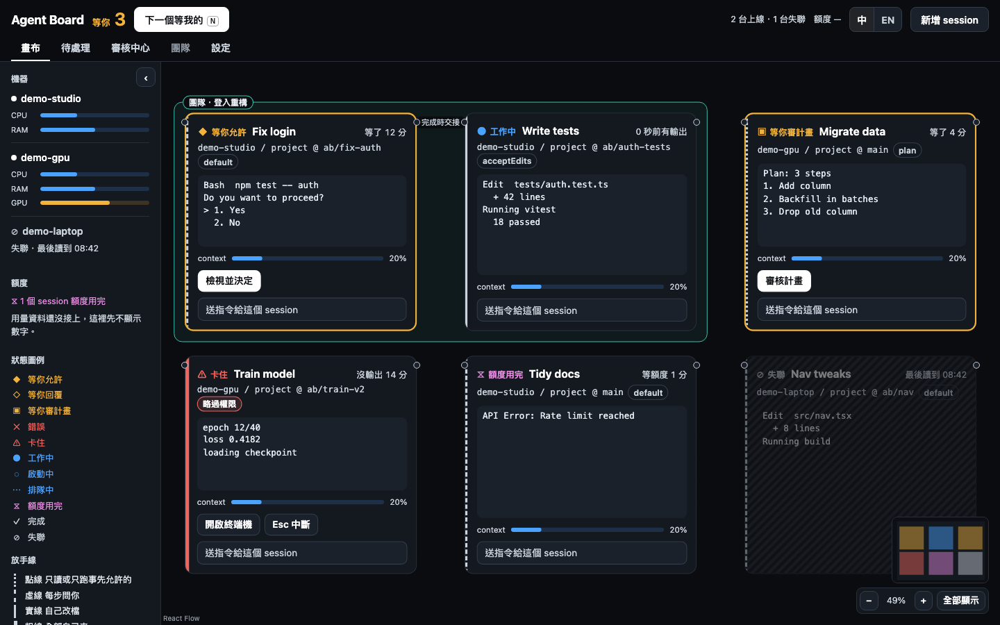
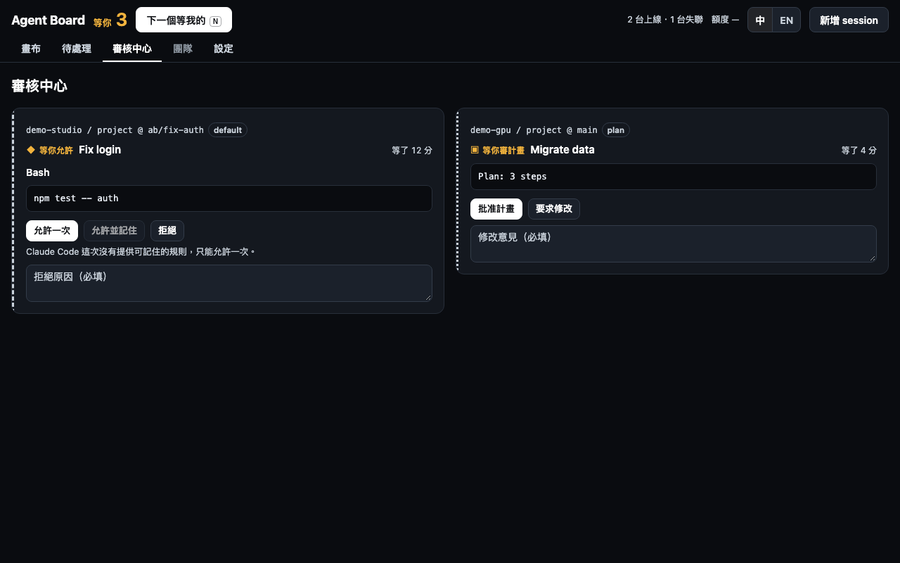
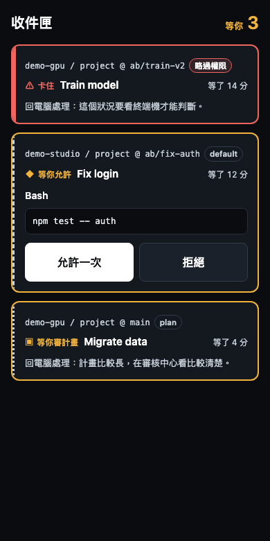
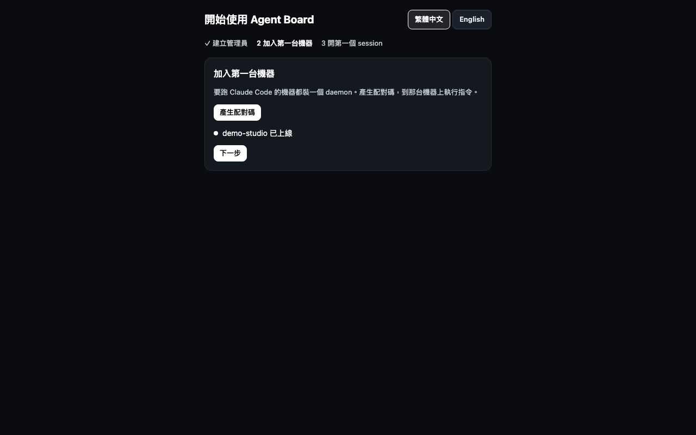

# Agent Board

[English](README.md)

自架的網頁中控台，管理你所有電腦上的 Claude Code session。每台機器跑自己已登入的 `claude`，網頁只是遙控器；關掉瀏覽器，session 照樣在跑。



- **真的終端機。** 用 xterm.js 畫 Claude Code 的原始輸出，不模仿、不重新排版。
- **到哪都能核准。** 在網頁或手機上看 diff、回答權限請求。
- **本身不碰模型。** 不呼叫任何 LLM、不需要 API key、不回傳使用資料，用的是每台機器自己的 `claude` 登入。
- **預設私有。** 只監聽 localhost 或私有網路，一定要登入。

| 審核中心                                       | 手機待處理                                  |
| ---------------------------------------------- | ------------------------------------------- |
|  |  |

## 各平台狀態

| 作業系統 | 狀態                                                                                                                                                                |
| -------- | ------------------------------------------------------------------------------------------------------------------------------------------------------------------- |
| macOS    | 已測試                                                                                                                                                              |
| Linux    | **未測試。** 安裝腳本與 systemd 設定已備妥，沒在真 Linux 上跑過                                                                                                     |
| Windows  | **已在一台實機安裝執行，完整實測未完成。** CI 會在 Windows 上跑單元測試。**自動更新目前有已知問題（健康檢查逾時），請保持關閉、用手動更新**。見 [Windows](#windows) |

## 開始之前

每台要跑 session 的機器都需要：

- [Node.js](https://nodejs.org) 22.18 以上（含 npm）。用 `node -v` 確認。各台的版本不必一樣：hub、daemon 與 session host 都用安裝時找到的那支 node，附的原生模組不分 Node 版本。
- [Claude Code](https://code.claude.com)，而且已登入。在終端機執行一次 `claude`，完成登入。
- 僅 Linux：編譯 `node-pty` 的工具，因為它沒有 Linux 預編譯檔。Debian／Ubuntu：`sudo apt install build-essential python3`。

只跑 hub 的機器只需要 Node.js。同一台電腦可以兩者都裝。

## 安裝

### 1. 裝 hub

選一台電腦放網頁中控台。

```sh
curl -fsSL https://github.com/OWNER/agent-board/releases/latest/download/install.sh | sh -s -- hub
```

Windows 用 PowerShell：

```powershell
Invoke-WebRequest https://github.com/OWNER/agent-board/releases/latest/download/install.ps1 -OutFile install.ps1
powershell -ExecutionPolicy Bypass -File install.ps1 hub
```

不需要 root 或系統管理員權限。裝完會印出網址，預設是 `http://127.0.0.1:8787`。如果這個埠被占用，在 `hub` 後面加 `--port 9000`。

想從原始碼建置而不下載發布檔，見[從原始碼安裝](#從原始碼安裝)。

### 2. 建立管理員帳號

用瀏覽器打開那個網址。第一次開啟會進入引導：選語言、填管理員名稱、設定至少 8 個字元的密碼。



### 3. 加入第一台機器

在引導中按**產生配對碼**。畫面會顯示配對碼（有時效、只能用一次）和一行含有 hub 網址的指令。

到要跑 session 的機器上，把這兩個值填進安裝指令：

```sh
curl -fsSL https://github.com/OWNER/agent-board/releases/latest/download/install.sh | sh -s -- daemon --hub 'http://127.0.0.1:8787' --code 你的配對碼
```

Windows：

```powershell
powershell -ExecutionPolicy Bypass -File install.ps1 daemon --hub 'http://127.0.0.1:8787' --code 你的配對碼
```

可以另外加 `--name '我的筆電'`，不加就用電腦的主機名稱。

機器連上後，引導畫面會自動更新。按**下一步**。

> 如果這台機器已經裝過 daemon，直接貼上畫面顯示的指令（`agent-board-daemon pair ...`）就好。服務會自動重試，大約一分鐘內連上。

### 4. 開第一個 session

選工作目錄和權限模式，開始 session。

**`claude` 第一次開某個資料夾時，會問你是否信任它。一定要回答，否則 session 不會往下走。** 在網頁上打開該 session 的終端機，選 `Yes, I trust this folder`。預先選好的是 `No, exit`，選它 session 就結束了。回答之前 Claude Code 不會執行 hook，所以狀態燈和網頁核准要等回答後才開始運作。

這樣就完成了。關掉網頁 session 繼續跑；重開機並登入後，hub 和 daemon 會自動啟動。

## 跨機器使用

hub 只監聽 `127.0.0.1`。要從其他機器連，請用私有網路。**Agent Board 沒有公開網路模式：** 能進來的人就能控制你所有機器的終端機。監聽所有網卡（`0.0.0.0`、`::`）會被拒絕。不要用連接埠轉發或 `tailscale funnel` 這類公開通道對外開放。

### 建議：私有網路上的反向代理

用 [Tailscale](https://tailscale.com) 的話，在 hub 那台機器上：

```sh
tailscale serve --bg 8787
```

你的版本語法不同的話，請看 `tailscale serve --help`。接著：

1. 在 hub 那台機器上打開 `http://127.0.0.1:8787`。
2. 到**設定 → 安全 → 對外網址**，填 HTTPS 網址，例如 `https://your-hub.your-tailnet.ts.net`，儲存。
3. 之後都用這個網址，包含配對時的 `--hub`。

**只要經過反向代理，就一定要設對外網址。** 沒設的話，WebSocket 連線會因來源不符被拒絕、配對指令顯示錯的網址、登入 cookie 也不會標記 `Secure`。Caddy、nginx 等也一樣。

Web Push 和安裝成手機 App 都需要 HTTPS，所以要在手機上用也是這個設定。

### 替代做法：監聽私有 IP

```sh
sh install.sh hub --host 100.64.0.1   # 換成這台機器自己的私有 IP
```

傳輸是未加密的 HTTP，只適合本來就有加密的網路（例如 Tailscale）。設了 `--host` 後，它會蓋過設定頁的監聽位址。

## Windows

原生 Windows（不是 WSL）、PowerShell 7，服務是工作排程器裡「登入時」啟動的工作。hub 預設不發自動更新給 Windows 機器，要逐台允許。

> **已知問題：Windows 自動更新目前會失敗。** 新版裝好後 60 秒內沒通過健康檢查，回滾也逾時（`health_timeout`、`rollback_failed`），之後舊版會自己起來。修好之前請**不要**在機器頁對 Windows 按「允許自動更新」或「立即更新」，改用下面的[手動更新](#windows-手動更新)。

**開始之前**（在 Windows 那台）：

1. [Node.js](https://nodejs.org) LTS，22.18 以上（含 npm）。開新的終端機用 `node -v` 確認。
2. [Git for Windows](https://git-scm.com/download/win)。Claude Code 的 Bash 工具用它的 bash，worktree 也要 git。
3. [Claude Code](https://code.claude.com)。在 PowerShell 執行一次 `claude`，完成登入。
4. [Tailscale](https://tailscale.com)，登入和 hub 同一個 tailnet。`tailscale status` 要看得到 hub 那台，瀏覽器打得開 hub 的公開來源（`https://your-hub.your-tailnet.ts.net`）。
5. PowerShell 7（`pwsh`）。

**安裝：**

1. 從 Release 頁下載 `agent-board-<版本>-win-x64.zip` 與 `SHA256SUMS`。
2. 驗檔：`(Get-FileHash -Algorithm SHA256 .\agent-board-<版本>-win-x64.zip).Hash.ToLower()` 要和 `SHA256SUMS` 裡 `win-x64` 那一行（`Select-String win-x64 .\SHA256SUMS`）一樣，不一樣就停下來。
3. 用內建的 tar 解壓：`New-Item -ItemType Directory $env:TEMP\agent-board-<版本>; tar -xf .\agent-board-<版本>-win-x64.zip -C $env:TEMP\agent-board-<版本>`。
4. 在網頁的 **設定 → 機器** 產生配對碼。
5. 填入 hub 網址、配對碼與這台的名稱後執行：

   ```powershell
   pwsh -NoProfile -ExecutionPolicy Bypass -File "$env:TEMP\agent-board-<版本>\agent-board\scripts\install.ps1" daemon --hub https://your-hub.your-tailnet.ts.net --code 配對碼 --name 這台的名稱
   ```

6. 確認工作在跑：`schtasks /Query /TN AgentBoard-session-host /V /FO LIST`、`schtasks /Query /TN AgentBoard-daemon /V /FO LIST`；網頁上這台顯示上線。

**允許自動更新之前先實測：**

1. 開一個 session，跑一個無害的指令，在網頁核准一次權限。
2. 在測試用的 repo 請它跑 `git push --force`：網頁要出現危險指令的核准。
3. 重啟 daemon：`schtasks /End /TN AgentBoard-daemon` 再 `schtasks /Run /TN AgentBoard-daemon`：session 不中斷、重新接上。
4. 登出 Windows 再登入：所有工作自己起來。
5. 下一版用同樣的方式手動安裝（新的 zip 照第 1–5 步）：正在跑的 session 不中斷。
6. 都沒問題，在網頁的 **機器** 頁對這台按 **允許自動更新** 並確認。之後就和 Mac 一樣自動更新；有問題按 **停止自動更新**，改回手動安裝。（**目前先不要做這一步**，見上面的已知問題。）

### Windows 手動更新

已經配對過的機器重跑安裝程式就是更新：會跳過配對，**不需要新的配對碼**；只重啟 daemon，session host 沒換版就不重啟，正在跑的 session 不中斷。

1. 取得新版的 `agent-board-<版本>-win-x64.zip` 與 `SHA256SUMS`（私人 repo 時可從 hub 那台的 `~/.agent-board/release-cache/<版本>/` 複製，那裡的檔案 hub 已驗過）。
2. 驗檔、用 tar 解壓（同安裝第 2、3 步）。
3. 先把舊的 daemon 關乾淨，再用**一般身分**的 `pwsh` 執行安裝（不用 `--hub`、`--code`）。0.1.13 以前的安裝程式停服務只下 `schtasks /End`，關不到 cmd 底下的 node，舊 daemon 會佔著 `daemon.lock` 讓新版起不來：

   ```powershell
   schtasks /End /TN AgentBoard-daemon
   Get-CimInstance Win32_Process -Filter "Name='node.exe'" | Where-Object { $_.CommandLine -match 'daemon\\dist\\index\.mjs' } | ForEach-Object { Stop-Process -Id $_.ProcessId -Force }
   ```

   只關 daemon，不關 session host，session 不中斷。接著：

   ```powershell
   pwsh -NoProfile -ExecutionPolicy Bypass -File "$env:TEMP\agent-board-<版本>\agent-board\scripts\install.ps1" daemon --from "<zip 的完整路徑>"
   ```

4. 等 2–3 分鐘再確認：`Get-Content $env:USERPROFILE\.agent-board\logs\daemon.log -Tail 15` 有「已連上」，機器頁顯示新版本。安裝程式若說服務沒起來，先再等 2 分鐘重看；daemon 在 Windows 上有時超過 1 分鐘才起來。
5. 還是不行：保留 `%USERPROFILE%\.agent-board\logs\` 的 updater.log、daemon.log、session-host.log 回報。舊版還在 `%LOCALAPPDATA%\agent-board\releases\<舊版本>`，可用舊版 zip 以同樣方式裝回。

紀錄在 `%USERPROFILE%\.agent-board\logs\`，程式在 `%LOCALAPPDATA%\agent-board\`。

## 功能與設定（0.1.8 起）

| 功能                                                   | 在哪裡設定或使用                                                                                                                                                    |
| ------------------------------------------------------ | ------------------------------------------------------------------------------------------------------------------------------------------------------------------- |
| Codex 派工（Codex session 用 agent-board 的 MCP 工具） | **設定 → Codex 掛派工工具**（預設關）。打開後新開的 Codex session 才有；已在跑的要重開。                                                                            |
| 交叉審查（Claude 與 Codex 唯讀審同一份變更）           | 網頁手動發起，或隊長用 `request_review`（每隊每小時 3 次）。                                                                                                        |
| 隊長加開申請                                           | 隊長超過團隊人數上限或 10 分鐘新增上限時，改成向你申請；在**收件匣 → 加開申請**同意或拒絕，30 分鐘沒處理自動失效。                                                  |
| 不是 git 的資料夾                                      | 新增團隊、補成員、新增 session、卡片 **⋯** 選單都有「在這裡 git init」（只有擁有者能用）；或勾「我知道風險：讓 BD 和 LD 共用這個資料夾」（只在非 git 資料夾生效）。 |
| 浮動對話框                                             | 新增 session／新增團隊／補成員／套用 Preset 在桌面可拖動，背後畫布可操作；雙擊標題列回到中間。                                                                      |
| 畫布分頁群組                                           | 分頁右鍵（觸控長按）→ 加入群組；群組名稱可收合、改名、換色。分頁沒有數量上限，放不下可橫向捲動。                                                                    |
| 升 stable 前 canary 要跑多久                           | **設定 → 機器與使用者 → 發版與自動更新**，0–168 小時，預設 0（不提醒）。                                                                                            |

## 日常指令

資料在 `~/.agent-board`（`hub.db`、`machine.json`、`sessions.json`、`logs/`）。程式在 `~/.local/share/agent-board`，Windows 在 `%LOCALAPPDATA%\agent-board`。

| 要做什麼 | macOS                                                        | Linux                                         | Windows                                      |
| -------- | ------------------------------------------------------------ | --------------------------------------------- | -------------------------------------------- |
| 看狀態   | `launchctl print gui/$(id -u)/com.agent-board.daemon`        | `systemctl --user status agent-board-daemon`  | `schtasks /Query /TN AgentBoard-daemon`      |
| 重新啟動 | `launchctl kickstart -k gui/$(id -u)/com.agent-board.daemon` | `systemctl --user restart agent-board-daemon` | `schtasks /End` 再 `/Run`                    |
| 紀錄     | `~/.agent-board/logs/daemon.log`                             | 相同                                          | `%USERPROFILE%\.agent-board\logs\daemon.log` |

hub 就把 `daemon` 換成 `hub`。

**升級：** 重跑一次同樣的安裝指令。內容沒變就什麼都不會重啟；有變的話服務會重啟，daemon 用 `claude --resume` 接回 session。

**退版：** hub 升級資料庫結構（schema）前，會自動把舊的 `hub.db` 備份成同資料夾的 `hub.db.bak-<日期>-<時間>-v<舊版本>`（本機時間、不含時區；只有擁有者能讀寫），備份路徑會寫進 hub 的 log；備份失敗就不升級。新版有問題要退回舊版時：

1. 停掉 hub 服務（macOS：`launchctl bootout gui/$(id -u)/com.agent-board.hub`；Linux：`systemctl --user stop agent-board-hub`；Windows：`schtasks /End /TN AgentBoard-hub`）。
2. 把要退回的那個備份複製回去，例如 `cp ~/.agent-board/hub.db.bak-20261108-090507-v8 ~/.agent-board/hub.db`，並刪掉同資料夾的 `hub.db-wal`、`hub.db-shm`（如果有）。備份之後的變更會遺失。
3. 用舊版的安裝檔重跑安裝指令（`--from <舊版 tar.gz 或資料夾>`）裝回舊版。

舊版 hub 開到新版資料庫時會拒絕啟動，錯誤訊息會列出同資料夾裡它能用的最新備份檔（依檔名裡的時間判斷；剛遇到夏令時間切換或改過時區時，請自己再看一下檔案時間）。

**選項：** `--port`、`--host`、`--name`、`--claude-bin <路徑>`、`--repair`（已配對也重新配對）、`--no-service`（不設開機自動啟動）、`--no-start`（只寫服務設定、不啟動）、`--from <tar.gz 或資料夾>`。

開機自動啟動的細節，包含 Windows 為什麼用排程工作：[docs/install/services.md](docs/install/services.md)。

## 疑難排解

| 看到什麼                                                                       | 怎麼做                                                                                                                                                                                                                                                                                                                               |
| ------------------------------------------------------------------------------ | ------------------------------------------------------------------------------------------------------------------------------------------------------------------------------------------------------------------------------------------------------------------------------------------------------------------------------------ |
| `agent-board-daemon: command not found`                                        | `~/.local/bin` 不在 `PATH` 上。把它加進去，或用完整路徑 `~/.local/bin/agent-board-daemon`。Windows 請開新的終端機。                                                                                                                                                                                                                  |
| `已被其他程式使用`                                                             | 加 `--port 9000`。如果已有配對好的機器，hub 網址變了，要重新配對。                                                                                                                                                                                                                                                                   |
| `找不到 claude`                                                                | 加 `--claude-bin /完整/路徑/claude`，路徑可用 `which claude` 查。                                                                                                                                                                                                                                                                    |
| 機器一直離線                                                                   | 看 daemon 紀錄。「沒有機器 token」表示還沒配對；「連不到 hub」請檢查網址與網路。                                                                                                                                                                                                                                                     |
| 配對被拒絕                                                                     | 配對碼只能用一次，也會過期。到**設定**產生新的。                                                                                                                                                                                                                                                                                     |
| session 一開就結束                                                             | 可能信任對話框選了 `No, exit`，或那台機器的 `claude` 沒登入。到那台機器手動執行一次 `claude`。                                                                                                                                                                                                                                       |
| session 開不起來，訊息提到 `settings.local.json`                               | 該專案的 `.claude/settings.local.json` 不是合法 JSON。Agent Board 不會覆蓋它，請修好檔案。                                                                                                                                                                                                                                           |
| session 開不起來：`找不到可執行的 agent-board-hook`                            | 少了這支 hook，危險指令檢查無法執行，所以會拒絕開 session。重跑一次安裝指令。                                                                                                                                                                                                                                                        |
| 經代理時網頁一直斷線                                                           | 設定對外網址（見上）。                                                                                                                                                                                                                                                                                                               |
| macOS：桌面或文件資料夾出現 `Operation not permitted`                          | macOS 隱私保護會限制背景程式。到**系統設定 → 隱私權與安全性 → 檔案和資料夾**允許 `node`，或改用其他資料夾。                                                                                                                                                                                                                          |
| macOS：`launchctl bootstrap` 失敗                                              | 多半是透過 SSH 執行、沒有桌面登入。下次登入桌面時服務會啟動。LaunchAgent 是登入時啟動，不是開機時。                                                                                                                                                                                                                                  |
| Linux：`npm ci` 卡在 `node-pty`                                                | 裝[開始之前](#開始之前)列的編譯工具。                                                                                                                                                                                                                                                                                                |
| Linux：`systemctl --user` 不能用（部分容器、WSL）                              | 手動啟動：`~/.local/bin/agent-board-daemon`。                                                                                                                                                                                                                                                                                        |
| Linux：重開機後要登入才會啟動                                                  | 執行 `loginctl enable-linger $USER`。安裝腳本會先試一次。                                                                                                                                                                                                                                                                            |
| 移除某個 Node 版本（nvm 等）後服務停了                                         | 用新版 Node 重跑一次安裝指令。                                                                                                                                                                                                                                                                                                       |
| 升級或重裝 Node（例如 `brew upgrade node`）後，session 卡在 starting、沒有畫面 | macOS 隱私權限照 node 執行檔認，換了 node 可能要重新允許：系統設定 →「隱私權與安全性」→「檔案和資料夾」或「完整磁碟取用權限」允許那支 node，再執行 `launchctl kickstart -k gui/$UID/com.agent-board.session-host`（會結束 agent，之後自動接回）。                                                                                    |
| 紀錄檔太大                                                                     | 目前還沒有自動輪替。可以直接刪，刪完重新啟動服務。                                                                                                                                                                                                                                                                                   |
| Windows：自動更新失敗，機器頁顯示 `health_timeout`／`rollback_failed`          | 已知問題。關掉這台的「允許自動更新」，用[手動更新](#windows-手動更新)。舊版通常幾分鐘後會自己起來。                                                                                                                                                                                                                                  |
| Windows：安裝程式說服務沒起來                                                  | 先等 2 分鐘再看 `daemon.log` 與 `schtasks /Query /TN AgentBoard-daemon`；仍沒起來就回報三份 log。                                                                                                                                                                                                                                    |
| Windows：用檔案總管解壓後執行被擋                                              | 改用 `tar -xf` 解壓（檔案總管會加「從網路下載」標記）。                                                                                                                                                                                                                                                                              |
| 按「升為 stable」跳出「還不到 24 小時」                                        | 是提醒不是限制，按確認即可。之後可在**設定 → 發版與自動更新**把門檻設成 0（0.1.12 起預設 0）。                                                                                                                                                                                                                                       |
| 畫布卡片看不到回覆、點進去打不了字（0.1.11–0.1.12）                            | 畫面內超過 8 張終端機卡時多的卡只有靜態文字。0.1.13 修正；舊版先用「開全尺寸」。                                                                                                                                                                                                                                                     |
| session 卡住、紀錄有 `authentication_failed`／`Login expired`                  | 那台機器的 `claude` 登入過期。在那台執行 `claude` 再 `/login`，回網頁重送。                                                                                                                                                                                                                                                          |
| 隊長開會改檔的成員被擋：「不是 git」                                           | 在卡片 **⋯** 或補成員時按「在這裡 git init」，或勾「讓 BD 和 LD 共用這個資料夾」。                                                                                                                                                                                                                                                   |
| Codex session 停在「Trust this folder?」                                       | Codex 第一次開這個資料夾要信任；選了會寫進你自己的 `~/.codex/config.toml`。                                                                                                                                                                                                                                                          |
| 每個 session 打字都沒反應（新開的也一樣），畫面照常更新                        | session host 的輸入可能卡住（0.1.14 起機器頁會顯示「session host 可能卡住」）。到**版本與更新**頁那台機器按**重啟 session host**：該機所有 agent 會結束一次，之後自動接回。舊版 daemon 在那台執行 `launchctl kickstart -k gui/$(id -u)/com.agent-board.session-host`（Linux：`systemctl --user restart agent-board-session-host`）。 |
| 忘記密碼                                                                       | 見下方[忘記密碼](#忘記密碼)。                                                                                                                                                                                                                                                                                                        |

### 忘記密碼

- **還有別的管理員：** 請他到**設定 → 使用者**，在你那一列按**重設密碼**，再把新密碼交給你。不需要你的舊密碼；你在所有裝置都會被登出。
- **你是唯一的管理員：** 在 hub 那台電腦上，用執行 hub 的那個帳號執行

  ```sh
  agent-board-hub reset-password <帳號>
  ```

  它會請你輸入兩次新密碼（不顯示），存好後把這個帳號在所有裝置登出；已開著的網頁約半分鐘內會斷線，要重新登入。hub 不用停。要寫進腳本時用管線傳入：`printf '%s\n' "$NEW_PASSWORD" | agent-board-hub reset-password <帳號>`。hub 用的不是預設資料夾時，先把 `AGENT_BOARD_DATA_DIR` 設成同一個。兩種方式都會在操作紀錄留一筆，不含密碼。

## 解除安裝

```sh
sh ~/.local/share/agent-board/current/scripts/install.sh --uninstall
```

Windows：

```powershell
pwsh -NoProfile -ExecutionPolicy Bypass -File "$env:LOCALAPPDATA\agent-board\current\scripts\install.ps1" --uninstall
```

0.1.0 以前的安裝，路徑裡是 `app` 而不是 `current`。

這會移除程式、服務與捷徑。資料保留在 `~/.agent-board`；加 `--purge` 連資料一起刪，包含 hub 資料庫與機器憑證。

有一件事要手動清：開過 session 的專案，`.claude/settings.local.json` 裡還留著 Agent Board 的 hook。請刪掉 `command` 開頭是 `agent-board-hook` 的項目。不刪的話，在那些專案裡用 `claude` 時，每次工具呼叫都會出現 hook 錯誤。

## 從原始碼安裝

還沒有發布檔或要開發時用。需要 `git`，並能連網下載依賴。

```sh
git clone https://github.com/OWNER/agent-board.git
cd agent-board
corepack pnpm install
corepack pnpm build:release
sh scripts/install.sh hub --from release/agent-board-0.1.2-darwin-arm64.tar.gz
```

daemon 也用同樣的 `--from`。要裝到其他機器，把 `release/agent-board-<版本>-<平台>.tar.gz`（Windows 是 `.zip`）複製過去。之後的新版由 hub 自動更新（CONTRACTS §21）。

從 0.1.1（曾經自帶 Node 的版本）升到 0.1.2 用同樣的 `--from` 手動裝：服務改回系統的 node，session host 不重啟（agent 不中斷），它資料夾裡留下的 `runtime/` 沒人用時會清掉。

## 安裝腳本做了什麼

- 只下載本專案的發布檔與 npm 依賴。不送出任何資料，也關閉 `npm audit`。
- 只寫使用者目錄，不需要 root。
- 不會覆蓋 `~/.local/bin` 裡不是它建立的檔案，也不改你的 shell 設定檔。
- 機器 token 只存在 `~/.agent-board/machine.json`（權限 0600），不會寫進服務設定。
- Linux 上會對你的帳號執行 `loginctl enable-linger`，服務才能開機啟動。Windows 上會把它的資料夾加進使用者 `PATH`。

## 授權

MIT。第三方授權：[THIRD_PARTY_NOTICES.md](THIRD_PARTY_NOTICES.md)。
